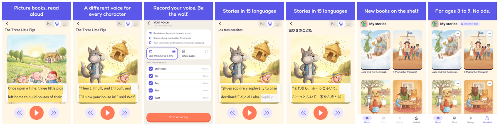
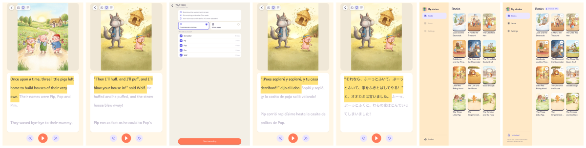
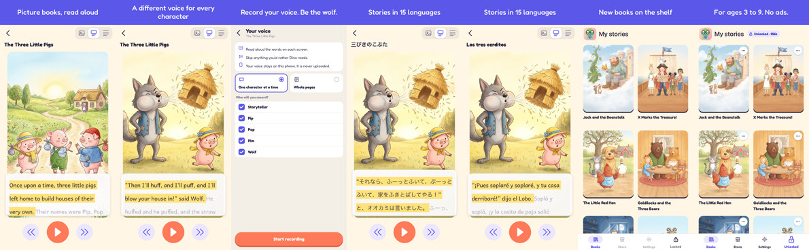
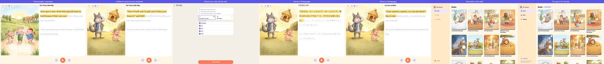

### Slice 433 — Dino: store screenshots in a new look, the App Store preview videos and the Play feature graphic (Google Play and App Store)
**Product:** Dino

*Closed 2026-11-25: all work items done (item 8 moved to Slice 444). The App Store sets and previews are on 1.136.5, WAITING_FOR_REVIEW (App Store Connect API, 2026-11-25), and show on the live App Store when Apple approves it. Checks still unrun are in docs/plan/unverified.md under Slice 433.*

*Plan-cleanup 2026-11-25: verdict keep open. Nothing is built on origin/main 1a8bf725 (no `store-size-check.ps1`, no `tools/dino/promo/store/`, no `store-shot-ios-duo-*` or `store-video-*` flows; `store-captions.ps1` still has the `#2F5D50` fill at :28 and the 0.15 band at :26). Two outside waits moved out of the work: item 4's push (App Store version editable) is a Watch line in plan.md; item 8 (Duo, waits on Slice 403, still `planned`) moved to a new slice, so this slice closes after items 1-7 and 9.*

*Planned 2026-11-24 from the phone doc [2026-11-23-dino-store-screenshots-and-video.md](../notes/2026-11-23-dino-store-screenshots-and-video.md) (Scope Inbox, status ready). Follow every line of that note's Constraints, Decisions (approved), Sizes, The six screenshots and Video timeline; this file wins where they differ.*

*Merged 2026-11-25 (PR #1342, merge 65b04815). Google Play live and read back (screenshots, tablet sets, feature graphic in 17 listing languages). The App Store sets and preview videos are built and staged; their push is the Watch line in plan.md, since Dino has no editable App Store version (1.136.0 and 1.131.1 both READY_FOR_SALE, read 2026-11-25).*

**Premise check (2026-11-24, before the claim):** `store-screenshots.yml` and `ios-sim-store-shots.sh` take screenshots only; simulator video recording (`xcrun simctl io <udid> recordVideo`) is new work in item 6. `tools/dino/promo/linkedin/` is two separate per-post HyperFrames projects with no shared template: item 6 copies one project's skeleton into `tools/dino/promo/store/`. Slice 403 is not built (plan-not-needed: 403), so item 8 stays in *Not yet verified*. `store-size-check.ps1` is owned by this slice; Slice 434 reuses it after this slice merges. The Dino palette and font are read from `src/Dino/DinoReader.App/Resources/` (read only).

**Touches:** `tools/emulator/store-captions.ps1`, `docs/store-listings/screenshots/captions.json`, `tools/emulator/test-store-captions.ps1`, `tools/emulator/store-screenshots.ps1`, `tools/emulator/test-store-screenshots.ps1`, `tools/emulator/screenshot-frames.json`, `tools/emulator/store-size-check.ps1` (new), `tools/emulator/store-frames.ps1` (new, review fix: the frame table shared by the caption and screenshot scripts), `tools/emulator/install-debug.ps1` and `tools/emulator/build-cache.ps1` (added 2026-11-24: the emulator's Dino Debug build reports version 1.0, below the live Android `minVersion` 1.131.1 read from `https://dinoreader.sirous.uk/api/app-config`, so every Dino emulator flow opened the "Dino needs an update" page; stamp 99.0.0 as `store-screenshots.yml` already does for iOS), `.maestro/dino/needs-file/store-shot-phone.yaml`, `.maestro/dino/needs-file/store-shot-tablet.yaml`, `.maestro/dino/store-shot-ios-*.yaml`, `.maestro/dino/store-shot-ios-duo-*.yaml` (new), `.maestro/dino/store-video-*.yaml` (new), `.github/scripts/ios-sim-store-shots.sh`, `.github/workflows/store-screenshots.yml`, `tools/dino/promo/store/**` (new), `docs/store-listings/screenshots/dino/**`, `docs/store-listings/dino/**`, `.claude/skills/store-listing/SKILL.md`, `tools/dino/full-shelf-books.json`, `.github/scripts/fetch-shelf-packages.mjs`, `.github/scripts/fetch-shelf-packages.test.mjs`, `docs/plan/slices/433-dino-store-screenshots-video-play-appstore.md`. It records what went live in `docs/plan/slices/291-store-listings-and-screenshots.md` and ticks `docs/plan/slices/404-dino-store-pictures-foldables-and-retake.md` items 4, 6 and 7 (record lines only).

**Replaces:** Slice 404 items 4 (the App Store retake, taken 2026-11-19 in the old green-frame look and never pushed) and 6 (the iPhone Duo set); 404's Decisions 1, 3, 5 (Duo sizes and simulator only, the 12-book `full-shelf` hook, never build a book package for screenshots) still hold here. The old caption tool's behaviour that stays: captions read from `captions.json`, the 45-character limit and its test, the `-Form tablet` switch; what goes on purpose: the `#2F5D50` green fill (`store-captions.ps1:28`, `:97`), the 15% band (`:26`) and the shrink-to-fit of the app screen (`Get-ShotRect`, `:51-56`). Windows (404 item 5) moves to Slice 434.

## Why

Dino's first week: few people tap Dino in the store lists (App Store 66 impressions to 4 page views; Play 48 impressions). The live Play shots came out at a strange ratio, on a dark green box, with the app screen shrunk inside it and the phone's status bar showing (user, 2026-11-23). The user asked for "a good video and better pictures".

## Decisions (settled, never re-ask)

- Everything in the note's *Decisions (approved)* (user, 2026-11-23): the language shot in English, Spanish and Japanese (never Farsi or Chinese outside their own local listing); the screen fills the picture edge to edge with a caption band at the top in the app's own colours and font (Play: at most 20% of the image), no device frame, no status bar; iPad in landscape (2752 x 2064 shots, 1600 x 1200 preview), replacing the live portrait iPad set; Play tablet shots without captions at 1440 x 2560; captions translated into every listing language, English first; video shots at most about 4 s, about 20 s in all; iPhone Duo sets after Slice 403.
- **This plan replaces the unfinished screenshot work of Slice 404** (user, 2026-11-24, approving the suggested answer): its retaken App Store sets are not pushed; the new look goes to every store.
- **Windows desktop shots and the 1920 x 1080 landscape video are Slice 434** (user, 2026-11-24), so phone, tablet and iPad do not wait for the VM work.
- The note's open question "Play tablet landscape" is closed by its own decision (portrait 1440 x 2560, decided by this planning session from the note).
- The green frame came from `tools/emulator/store-captions.ps1` (answered from the code, 2026-11-24).
- **Preview video captions sit in the middle, not in a top band** (user, 2026-11-25, on the first rendered previews: "the text over is written on top? why? no one will see that! I think it should be in the middle of the page"). For the App Store preview videos only (`tools/dino/promo/store/index.html`, `variants/ipad.html`): no top caption band; the app footage uses the whole frame (status bar cut off, the rest centred on the app's sand); each caption is a Brand `#5B57E8` rounded panel with white Fredoka text in the vertical middle of the frame. The screenshots keep their top band. The end frame keeps its icon and name, but its "Some books need a subscription" line left the top band too, as the same middle panel under "Dino / Kids Books & Stories" (coordinator, 2026-11-25: the user's objection to a top band covers it).
- **Each preview segment opens on its own footage, dimmed and blurred, under its caption** (user, 2026-11-25, "ok. do it" to the proposal): each segment opens on its own app footage dimmed and blurred with the caption large in the vertical middle for about 0.7 s; then the blur and caption fade away and the action plays (page turns, shelf scrolls); a short fade between segments. No text-only pages: every frame stays app footage (App Store guideline 2.3.4: previews are screen captures plus overlays only). About 20 s in all; the 5 s poster frame is clean footage of the voices shot (no blur, no caption at 5.0 s); the end frame is unchanged. Built with the HyperFrames blur and exposure treatment animated back to neutral, and the cuts moved so each action starts about 1.1 s into its clip; segments 0-3, 3-6, 6-9.4 (record), 9.4-13 (English 1.6 s, Spanish and Japanese 1 s each), 13-16, end frame 16-20.

## Work

- [x] 1. (built 2026-11-24, fast checks green; the device proof is item 2) **New caption frame.** Rewrite `store-captions.ps1` so the app screen fills the output edge to edge at the exact store size with a top caption band in the app's palette and font (colours and font read from the Dino app's resources, named in the slice when built), no other colour, no letterbox, no stretch; crop the status bar off the raw shot (or demo mode, the note's Constraints). New `store-size-check.ps1`: fails any file whose pixel size, ratio or alpha does not match the note's *Sizes* row; every upload step runs it first. `test-store-captions.ps1` asserts the exact output sizes and that no pixel outside the band and the screen comes from outside the palette.
- [x] 2. (live on Play 2026-11-25, read back) **First step: six English Play phone shots at 1080 x 1920** (the note's six screens and captions, in order), contact sheet written into this slice, then pushed through the `store-listing` agent and read back.
- [x] 3. (live on Play 2026-11-25, 7" and 10", read back) Play tablet set: the same six screens at 1440 x 2560, no captions; pushed and read back.
- [x] 4. (built: raw sets in `docs/store-listings/screenshots/dino/{iphone-6.9,ipad-13}`, captioned sets made for 15 languages; push = Watch line) App Store sets from `store-screenshots.yml`: iPhone 6.9" 1320 x 2868 and iPad 13" landscape 2752 x 2064 (new landscape iPad flows), captioned; built and stored in the `store-shots-*` draft release by this slice; the push is not this slice's wait: when a Dino version is editable (PREPARE_FOR_SUBMISSION; never cancel a review, 404 rule) the Watch line in plan.md pushes and reads them back [moved out 2026-11-25].
- [x] 5. (Play: live in all 17 listing languages 2026-11-25; App Store sets staged for the Watch line; machine drafts, native read in `unverified.md`) Translated captions for every listing language (parents' own search words, not word for word; Farsi only on the Farsi listing; Apple has no Farsi listing), each set pushed and read back. Update `.claude/skills/store-listing/SKILL.md`'s screen-language rule to English, Spanish and Japanese for the languages shot (the note replaces "German or French").
- [x] 6. (built and encoded 2026-11-25, both pass `store-size-check.ps1`; push = Watch line, with the 5 s poster frame) **App Store preview videos** with the note's video timeline: real app footage only (simulator screen recordings from the macOS job, no hands or devices), composed and captioned with HyperFrames in `tools/dino/promo/store/` (reuse `tools/dino/promo/linkedin/`'s setup), the end frame saying some books need a subscription, the 5 s poster frame on the character-voices shot. iPhone 886 x 1920 portrait and iPad 1600 x 1200 landscape; re-read Apple's app preview specifications page before encoding (the note read them partly). Encoded to Apple's spec (15-30 s, at most 30 fps, H.264 10-12 Mbps, AAC 256 kbps stereo), pushed, read back.
- [x] 7. (live on Play 2026-11-25 in all 17 languages, read back) Play feature graphic 1024 x 500 (Dino plus one book picture, name centred, no alpha); the user asked for a new one, which lifts the skill's "stays unless the user asks" line. Pushed and read back.
- [moved out 2026-11-25] 8. iPhone Duo screenshot sets (outer 1398 x 2034, inner 2007 x 2853) and a Duo preview (886 x 1920): waiting on Slice 403 (still `planned`) is not this slice's work; moved to a new slice that starts after 403. The Duo `screenshotDisplayType` rule goes with it.
- [x] 9. (2026-11-25: Slice 291's block "Dino Play push 2026-11-25"; Slice 404 items 4, 6, 7 already ticked as replaced) Record what went live per store in Slice 291's file and tick Slice 404 items 4, 6 and 7 as replaced by this slice.
- [x] 10. (built 2026-11-25; App Store draft 1.136.5: see the push line below) Preview video captions in each App Store locale's language (user, 2026-11-25: 'why the caption on video is not updated per language? it is all in english').

**Built so far (implement-slice, 2026-11-24; code and flows only, nothing run on a device, nothing pushed to a store).** Item 1: `store-captions.ps1` (band Brand `#5B57E8` from `App.xaml`, white text, Fredoka Medium from `Resources/Fonts`, Vazirmatn for fa/ar, Yu Gothic UI / Microsoft YaHei UI for ja/zh; width-fit crop that fails instead of stretching or letterboxing; `-Form phone|tablet|iphone-6.9|ipad-13`), `store-size-check.ps1` (images and preview videos), `store-screenshots.ps1` (sets `wm size` so the raw shot fits the frame exactly, writes `frame-info.json`, resets the display), tests in `test-store-captions.ps1` and `test-store-screenshots.ps1`. Item 2/3: six-shot Play phone and tablet flows (the Japanese language shot is an extra seventh file; its caption is the language one). Item 4: six iOS flows `store-shot-ios-1-picture ... 6-ages`; `ios-sim-store-shots.sh` turns Dino's iPad to landscape by adding `setOrientation: LANDSCAPE_LEFT` to its copy of each flow (one set of flows serves both devices, instead of separate iPad flows); the workflow's `all` is now iphone-6.9 and ipad-13. Item 5: `captions.json` for all 15 listing languages (machine drafts in parents' search words, native read owed in `unverified.md`) and the skill's screen-language rule. Item 6: `store-shot-ios-video-<n>-<screen>.yaml` footage flows (named `store-shot-ios-` so the flow lint, `run-flows.ps1` and `FullShelfPlanTests` leave them as store flows, not `store-video-*`), recorded by `ios-sim-store-shots.sh` with `xcrun simctl io <udid> recordVideo`, and the HyperFrames project `tools/dino/promo/store/` (iPhone `index.html`, `variants/ipad.html`, `store-media.mjs` cut and Apple-spec encode, `footage-cuts.json` whose seconds are first guesses to tune on the real recordings). Item 7: `variants/feature-graphic.html`, rendered once here and passing `store-size-check.ps1 -Target play-feature`. Not built: item 8 (Duo flows, after Slice 403), every device run, CI run, push and read back. The note's caption "New books on the shelf" needed the old banned word `new` removed from the caption rules.

**iOS CI runs, 2026-11-24/25 (store-screenshots.yml, runs 45466463555 to 45529072677).** Screenshots done and checked by eye on small copies: iPhone 6.9" 7 of 7 (run 45521621292 plus kept files), iPad 13" 7 of 7, 2752 x 2064 upright (run 45521616983 plus kept files). Fixed on the way (commits f2469cb9 to ddd1916c): English reset by hook in every flow, URL scheme pre-approval (no "Open in" alert), cross-commit resume, fail fast, landscape shots turned upright, shelf refill when shot 1 is kept, 8 s Open-in waits once approved, Reduce Motion on the simulators (the wait overlay's endless hop stalled every Maestro check; read back as 1 on the booted iPad, and the iPad clip setups and voices shot then passed), clip 1b starts the read in its setup.
Open, preview clips (not shippable yet):
- `swipe` with `direction:` reports COMPLETED on iOS 27.2 / Maestro 2.12.0 but moves nothing: the iPhone shelf in clip 4-shelf never scrolls, the iPad page in clip 1a never turns (the iPhone page does). Cause unknown; an explicit start/end swipe is the same path (review `reviews/s433-swipe-high.md`), so the next try must differ: a `dino-test://` hook that turns the page or scrolls the shelf, or re-asserting the orientation in the recorded flow on the iPad.
- `launchApp` sometimes hangs until the kill (iPad clip 2-record twice in run 45521616983, iPhone shot 3 once in run 45512162060). Cause unknown.
- The simulator recordings have no sound (`simctl io recordVideo` is video only), so the "voices" clip is silent; the HyperFrames composition needs the read's audio from elsewhere or captions instead.
- Run time: iPad run 45597845229 spent 10:50:43-11:02:00Z (11 min) silent while it created the simulator and booted it for the first time, then 11:02-11:05:25Z (3.5 min) setting Reduce Motion. Cut both, for example by reusing the image's pre-booted simulator or by setting Reduce Motion before the first boot; target 10-15 min less per run (coordinator, 2026-11-25).

**Runs 45531807696 and 45534156337 (2026-11-25), checked frame by frame over the whole recording.** The test hooks work: clip 1a turns page 5 to 6 (iPhone 49 s in, iPad 194 s in), the iPad shelf scrolls from row 1 to row 3 at 49 s (the second scroll hits the end of the 12-book shelf), 2-record opens the book menu and "Your voice" from 31 s. The earlier "1a never turns" came from looking only at the first seconds. The real fault: Maestro takes 31 to 194 s after `recordVideo` starts before the clip flow's first step, varying per run, so the fixed `leadIn` 0.5 s cuts a still screen every time.

**iPad run 45582715957 (commit 54f25bae), why the files are shorter than the wall clock (frame pts dumped with `ffprobe -show_frames`, 2026-11-25).** `simctl io recordVideo` writes a variable-frame-rate mp4 (time base 1/600): a frame only when the screen changes, each stamped with its real time since the recorder's first frame (t = 0 is the first frame, gaps are kept at their true length, nothing is dropped or squeezed: 2-record's clock-like 1 s cadence runs to 86.77 s over 94 s of wall time). The file ENDS at the last changed frame: a still tail is never written. 3-language-en has 4 frames (0, 27.56, 29.41, 29.42 s), so its 29.4 s file ends where the screen last changed, while the page was held until 66+ s. The length check passed because the runner (image xcode-27-arm64) has no ffprobe, so `recording_readable` fell back to "has a moov atom". Every mark was about 66 s because Maestro needs about 60 s from `maestro test` to the first step (driver start) while the recorder already runs; 2-record's 4 s window after its first step (the ... tap) ends before "Record your voice" is even tapped (5.6 s later); 1a failed twice on "iOS driver not ready in time"; es, ja and 4-shelf were never tried (budget gone).

Design, the cut point per recording (in-flow recording, replaces the wall-clock mark of commit 54f25bae; Maestro 2.12.0 behaviour read from its source at tag cli-2.12.0 by the library-docs agent, 2026-11-25):
1. **Maestro records inside the flow.** `startRecording` / `stopRecording` work on iOS simulators (`SimctlIOSDevice` runs `xcrun simctl io <udid> recordVideo --codec h264`, the same recorder), the file is `<test-output-dir>/<timestamp>/<flow name>/startRecording/<path>.mp4`, and the flow's `commands.json` beside it lists every step with `metadata.timestamp` (epoch ms at the step's start), `duration` (ms), `status` and `depth`, for passed and failed flows.
2. **One Maestro invocation per device for all missing clips**, so the iOS driver starts once: `ios-sim-store-shots.sh` writes a folder with one generated flow per clip, `clip-<clip>.yaml` = `runFlow: prep/prep-<clip>.yaml` (the unrecorded `store-shot-ios-videoprep-<clip>.yaml`, rotated on the iPad as before), `startRecording: clip-<clip>`, the steps of `store-shot-ios-video-<clip>.yaml`, `stopRecording`; and a `config.yaml` with `executionOrder.flowsOrder` (the clips in order) and `continueOnFailure: true`. Limit: 240 s of driver start + 240 s per clip. The clips that did not come out get one more invocation after a simulator restart (round 2), only when it fits the budget.
3. **The mark comes from Maestro's own step times, not the wall clock**: t = 0 is the end of the `startRecording` step; `store-media.mjs mark <commands.json> <clip> <out.mark>` writes two lines, the mark = end of the clip's `markStep`-th recorded top-level step, and the span = start of `stopRecording` (how long the recorder ran), and prints every recorded step's times into the job log. A flow that never reached `stopRecording`, or had a step end other than COMPLETED, WARNED or SKIPPED, gives no mark (retaken). A one-line mark file of the old design is refused, so old recordings are retaken.
4. `footage-cuts.json`: each clip is `{ markStep, markAt, beforeMark, seconds }`; the mark is the start or end (`markAt`) of the `markStep`-th recorded step and the cut is `max(0, mark - beforeMark)` for `seconds`. Tuned on the frames of runs 45597845229 (iPad) and 45597851145 (iPhone): an `openLink` hook step lasts about 2-3 s and the app acts about 0.9-1.5 s after it STARTS, so **1a-reading** (turn-page hook, step 2) and **4-shelf** (first scroll hook, step 2) mark their hook step's start. That was not enough: across four runs the turn came 0.3 to 3.3 s after the step's start (iPhone run 45607850849: start 2.14 s, turn 5.43 s), so these two clips also have `"snap": "nextChange"`: `store-media.mjs` anchors the cut on the recording's first frame after the mark (simctl writes a frame only on a screen change, so that frame IS the action's start), 0.8 s (1a) and 0.5 s (4-shelf) before it, and `check` fails a recording with no change after the mark. **2-record**: the book sheet closes about 3 s before the "Your voice" record intro appears (iPad: sheet until 15.8 s, intro at 19.0 s), so the clip is the intro: mark = end of step 4 (the wait for `RecordIntroStart`), 1.7 s before it (step 1, the `...` tap, had ended 5.6 s before the record tap in run 45582715957).
5. **The length check fails hard without ffprobe**: the workflow installs ffmpeg (`brew install ffmpeg`) in the clips job, `run_video_units` records nothing when `ffprobe` is not on the PATH, and `store-media.mjs check` (a clip is kept only when it passes) throws when ffprobe is missing. It checks that ffprobe reads video packets to the end and that the span covers `cut start + seconds`; it does NOT compare the file's duration, since simctl ends the file at the last screen change.
6. **The cut holds the still tail**: `store-media.mjs cut` makes the recording constant-rate (`fps=30`), clones the last frame (`tpad=stop_mode=clone`), then trims by timestamp (`trim=start:duration`, no `-ss` seek, which would drop the frame on screen at the cut start). Tried on the real 3-language-en recording of run 45582715957: a cut at 65.35 s + 1 s gives 30 frames of 1.000 s.
7. After a passing run the script prints the app HOOK lines (unchanged, review `reviews/s433-hooklines-high.md`).

**Built and proven (2026-11-25).** Commits 53eb4a5e (in-flow recording, one Maestro run per device, ffprobe required, the cut holds the still tail), c7505375 (`markAt`, 2-record = the Your voice intro) and 69a324ef (`snap`). CI runs on c7505375, `media=clips`: iPad 45607845756 success, 7 of 7 in round 1 (draft `store-clips-dino-ipad-13-45607845756`); iPhone 45607850849 attempt 2 success, 7 of 7 in round 1 (draft `store-clips-dino-iphone-6.9-45607850849`; attempt 1 failed on "iOS driver not ready in time" before any clip, and round 2 did not fit the budget). Earlier runs on 53eb4a5e: iPad 45597845229 and iPhone 45597851145 (attempt 2) both 7 of 7, used to tune the cuts. Media-review frame by frame of the c7505375 recordings, cut with the final `footage-cuts.json` (contact sheets also checked by the session): **iPad 7 of 7 PASS, iPhone 7 of 7 PASS** (1a turns page 5 to 6, 2-record holds the Your voice intro, 3-language en/es/ja show the page in that language, 4-shelf scrolls). Weak: **1b-voices** shows the page with Pause up, but the lit line does not move in its 3 s on either device (iPad 2 frames, iPhone 1 frame), so it reads as a still; a longer hold or a later window is the next try. `snap` was proven by re-cutting those CI recordings locally (no new CI run: recordings and marks do not change, only the cut and `check`); commit 69a324ef had no review pass.
- ~~Open: when round 1 dies on the driver start, round 2 never fits the budget~~ Fixed in commit 53fc1095: the clip batch waits up to 300 s for Maestro's driver (MAESTRO_DRIVER_STARTUP_TIMEOUT; Maestro 2.12.0 starts its iOS driver anew in every `maestro test`, LocalXCTestInstaller.kt, and the iPhone warm-up needed 214 s) and 150 s per clip (measured 54 to 111 s), so round 2 after a round 1 that died on the driver start costs 1830 s and fits (attempt 1 of run 45607850849 had about 2200 s left).

**Clip 1b, run time and the preview videos (2026-11-25, commit 53fc1095 plus the preview commit).**
- **1b-voices fixed:** the hold is 14 s and the cut snaps on the first lit-line change (the highlight moves a sentence at a time: Wolf line, then "He huffed and he puffed ..."). CI runs on 53fc1095, `media=clips`: iPad 45623393332 success, 7 of 7 in round 1 (draft `store-clips-dino-ipad-13-45623393332`); iPhone 45623398223 success, 7 of 7 in round 1 (draft `store-clips-dino-iphone-6.9-45623398223`). Media-review over the whole recordings: all 14 clips PASS; 1b's lit line moves 2.4 s into the clip on both devices (iPad change at 2.95 s, iPhone at 5.66 s of the recording). The local footage in `assets/footage/{ipad,iphone}` is cut from these two runs.
- **Run time:** the simulator is created and booted in the background from the workflow step "Boot the simulator early" (`ios-sim-store-preboot.sh`), with the URL scheme approval and Reduce Motion written before its first boot (`ios-sim-store-prefs.sh` through `ios-sim-boot.sh`'s `SIM_BEFORE_BOOT_SCRIPT`); `use_preboot` takes it, a failed or late pre-boot is deleted and the old boot path runs. Step "Take the shots": iPad 32.1 min (run 45607845756) to 22.2 min, iPhone 33.3 min (45607850849 attempt 2) to 22.4 min. But the whole job did not get shorter: the boot competes with the workload install (0.5 to 6 min) and the build (2.5 to 9.4 min), so the iPad job went from 37.6 to 42.7 min and the iPhone job from 40.3 to 40.0 min. On the iPad the pre-boot values held (no second boot); on the iPhone they did not ("the pre-boot values did not hold", the second boot ran as before).
- Open (run time): the target of 10-15 min less per job is not met. Next try: start the pre-boot after the build (it then overlaps only Maestro, ffmpeg and the package steps), or write the two values with `simctl spawn defaults write` on the booted simulator and find out whether the app sees Reduce Motion without a reboot; and find out why the iPhone's pre-boot values did not hold (the log names which of the two was missing).
- **Preview videos built** with HyperFrames (`tools/dino/promo/store/index.html` for the iPhone 886 x 1920, `variants/ipad.html` for the iPad 1600 x 1200), the user's two decisions above (captions in the middle; each segment opens 0.7 s dimmed and blurred under its caption), 20 s, the 5 s poster frame clean on the voices shot with the Wolf line lit. Encoded by `store-media.mjs encode` to Apple's spec as re-read on 2026-11-25 (H.264 High Profile Level 4.0, 30 fps, 11 Mbps constant bit rate, AAC 256 kbps stereo 48 kHz; the average-rate encode came out at 2.8 to 3.4 Mbps and failed `store-size-check.ps1`, so the encode is now CBR); both pass `store-size-check.ps1 -Target preview-iphone|preview-ipad`. Sound: the existing music bed `assets/bgm/cheerful-kids-11.m4a` at 40% (the previews autoplay muted; the footage is silent). Renders (local, not committed): `tools/dino/promo/store/renders/dino-preview-iphone.mp4` and `dino-preview-ipad.mp4`. Media-review: both PASS (every segment shows its action after its caption leaves, captions readable, no status bar, no top band).
- Open (previews): not pushed to App Store Connect yet (the item's push and read back); the iPad footage shows iPadOS's small window resize grip in the bottom-right corner of every frame (cosmetic; crop or hide it if wanted); the Spanish and Japanese segments are 1 s stills, as the note's timeline asks.
- **Review of the previews and the feature graphic (2026-11-25):** pass 1 (`reviews/s433-preview-high.md`) found 7 nits, no correctness bug; the first pass 2 did not run its fork, so pass 2 was run again over the final branch (`reviews/s433-final-medium.md`): 5 nits, no correctness bug. Applied #3 of pass 1 (the stale "end frame keeps its band" comments in `index.html` and `variants/ipad.html`). run-checks green: store-media tests 12/12, hyperframes check passes (its `line_unread` warnings on the 0.93 s caption windows are the user's 0.7 s caption decision of 2026-11-25, kept), test-store-captions and test-store-screenshots pass, lint-flows 167/0, fetch-shelf-packages tests 5/5, DinoReader.Tests 4870 passed 2 skipped.
- **Feature graphic (item 7):** rendered with `npm run render:feature` and `flatten-still.ps1`, 1024 x 500 24-bit, passes `store-size-check.ps1 -Target play-feature`, checked by eye: Three Little Pigs cover left, "Dino / Kids Books & Stories" centred, app icon right, no text in a top band (the user's 2026-11-25 middle-text decision holds; only a 14 px Brand bar at the top). File: `docs/store-listings/screenshots/dino/play-feature-graphic.png`.
- **Screenshot sets in the repo (items 2-4):** the raw shots are in `docs/store-listings/screenshots/dino/{phone,tablet}` (Android emulator run of 2026-11-24, 7 files each, with `frame-info.json`) and `{iphone-6.9,ipad-13}` (draft releases `store-shots-dino-iphone-6.9-45521621292` and `store-shots-dino-ipad-13-45521616983`); the old 5-shot sets are removed. English captioned sets made by `store-captions.ps1`: `phone-captioned/en`, `tablet-framed`, `iphone-6.9-captioned/en`, `ipad-13-captioned/en`; all pass `store-size-check.ps1`. Upload order on every store: 1-picture, 2-voices, 3-record, 4-language (Spanish), 4-language-ja, 5-shelf, 6-ages. The old `iphone-6.5` set stays in the repo for now (the 6.9 set covers 6.5 on the App Store). Store push and read back follow after the merge. Contact sheets:

  
  
  
  

**Store push (2026-11-25, after the merge of #1342 at 65b04815; `store-listing` agent, apply mode).**
- Google Play: live and read back. 17 listing languages x (phone set with that language's captions, 7" and 10" tablet sets, feature graphic): 68 sets, SHA-1 and order match the repo files, 0 mismatches; every file passed `store-size-check.ps1`. Record: Slice 291, "Dino Play push 2026-11-25".
- App Store: not pushed. Dino has no editable version (1.136.0 and 1.131.1 `READY_FOR_SALE`); the store-listing skill never creates one. The iPhone 6.9" and iPad 13" captioned sets (15 languages, all passing the size check) and both preview videos are staged; the push is the Watch line in plan.md, which also names the owner step (create the next Dino version, or let Claude create the draft). Apple's fallback of other locales to the primary locale's preview was not confirmed (the help page was cut off), so the Watch line pushes previews to every locale.

Rules on the way: `.github/CLAUDE.md` (no Actions artifacts: shots and videos go to the `store-shots-*` draft release; iOS shots only from `store-screenshots.yml`), `tools/CLAUDE.md` (status-bar demo mode cannot be read back: the proof is the shot), the 12-book `full-shelf` hook and never building a book package (404 Decisions 3 and 5). Android and iOS both get the new look in this slice.

## Verification

- `tools/emulator/test-store-captions.ps1` and `store-size-check.ps1` pass on every file before upload; `tools-selftests.yml` green.
- Each store's set and video read back through its API (Play edits, App Store Connect) with the expected sizes and order; contact sheets in this file.
- The Play page and App Store page show the new set (checked in Chrome on the live pages after release, by the run that pushed them).

#### From review

- In-flow recording, pass 1 (`reviews/s433-inflow-high.md`): applied #1 (round 2 starts only when the restart plus the whole round fit), #4 (ffmpeg step capped at 8 min, job 90 min), #5/#6 (fallback search for the mp4 and `commands*.json`, the output folder listed when nothing is found), #7 (README), #8 (`run_video_units` split into `clips_can_start`, `run_clip_retry`), #9 (a round that could not start is not retried).
- Skipped #2 (`reviews/s433-inflow-high.md`): "no longer compares the file's length with anything" - the file's length cannot tell a dead recorder from a still tail (simctl ends the file at the last change), so the frame-by-frame media-review of every clip is the check.
- Skipped #3 (`reviews/s433-inflow-high.md`): "t = 0 of the recording is taken as the end of the" - no frame carries its capture time on Maestro's clock; the first recorded step of every clip is a hold or a sheet already on screen, so a lag under about 1 s only shifts the window inside that hold, and the media-review of the real run is the proof.
- In-flow recording, pass 2 (`reviews/s433-inflow-medium.md`): applied #5 (why a kept recording is refused is logged).
- Skipped #1 (`reviews/s433-inflow-medium.md`): "BSD find on the" - macOS find has `-quit`, and the screenshot collector has used it on these runners in every run.
- Skipped #2 (`reviews/s433-inflow-medium.md`): "the paths that locate commands.json are guesses never run" - read from Maestro 2.12.0's source, with a fallback search; the CI run is the proof.
- Skipped #3 (`reviews/s433-inflow-medium.md`): "nested prep steps count as top" - Maestro 2.12.0 writes `depth` (FlowDebugOutput.kt), and a missing one counts as top level.
- Skipped #4 (`reviews/s433-inflow-medium.md`): "keeps a recording from an earlier draft without checking the markStep" - a resume from another commit already drops files whose flows changed; a `footage-cuts.json` change alone means rerunning the clips.
- Skipped #6 (`reviews/s433-inflow-medium.md`): "if an rtst clips entry were ever scheduled" - the matrix has no RTST clips job.

- Skipped #9 (`reviews/s433-high.md`): "`Get-InsetBarPx` takes the first `type=statusBars` or `type=navigationBars` line anywhere in the whole `dumpsys window` output" - the format is proven by the first emulator run, which reads the real dumpsys output; the shot's crop is compared with the demo-mode bar then.
- Skipped #10 (`reviews/s433-high.md`): "Nothing in the diff shows that Maestro's iOS driver supports `setOrientation`, or that a rotated iPad recording comes out landscape" - `setOrientation` and the landscape recording size are proven by the first `store-screenshots.yml` run.
- Skipped #1 (`reviews/s433-medium.md`): "Dispatching Dino with" `iphone-6.5` fails with "unknown device" - not a bug: `device_specs` echoes the `iphone-6.5` line before the `if [ "$APP" = dino ]` branch, so Dino matches it; only the matrix `exclude` drops it for `device: all`.
- Preview review, pass 1 (`reviews/s433-preview-high.md`): applied #3; pass 2 over the final branch (`reviews/s433-final-medium.md`) found 5 nits, all left as they are (lines below).
- Skipped #1 (`reviews/s433-preview-high.md`): "The timeline test passes only because the clip total is still 16" - the per-clip lengths are fixed in `footage-cuts.json` and the media-review of both renders checked every segment; a sync test is tooling for a later change.
- Skipped #2 (`reviews/s433-preview-high.md`): "The _comment keeps the old per-clip numbers" - comment-only in a JSON; the values are the source.
- Skipped #4 (`reviews/s433-preview-high.md`): "dim-and-blur payload in data-color-grading" - frames at 11.6 s and 12.6 s of the iPad render were extracted and are clean.
- Skipped #5 (`reviews/s433-preview-high.md`): "The same timing is hand-copied into both compositions" - pass 2 checked the two compositions and the cuts agree; a sync test is later tooling.
- Skipped #6 (`reviews/s433-preview-high.md`): "The preview check never reads the H.264 level" - pre-existing; both encodes probe at High level 4.0 and about 10.9 Mbps.
- Skipped #7 (`reviews/s433-preview-high.md`): "The offset is left from the removed 84 px top band" - the iPad end frame at 18.5 s was looked at and reads as centred enough; cosmetic.
- Skipped #1 (`reviews/s433-final-medium.md`): "a folder-order upload swaps them" - every upload brief names the order (1-picture, 2-voices, 3-record, 4-language, 4-language-ja, 5-shelf, 6-ages), never folder order.
- Skipped #2 (`reviews/s433-final-medium.md`): "titles say" "three 1 s language clips" - test title wording only; the test values are right.
- Skipped #3 (`reviews/s433-final-medium.md`): "keeps the removed top band's offset" - same as pass 1 #7; the end frames were looked at and read well.
- Skipped #4 (`reviews/s433-final-medium.md`): "start action later than" - the media-review of both renders passed every segment, 2-record included.
- Skipped #5 (`reviews/s433-final-medium.md`): "may raise HyperFrames line_unread warnings" - they do, and they come from the user's 0.7 s caption decision of 2026-11-25.
- Applied after review pass 2: one recording per preview clip (findings 3 and 6). Seven clips, each a setup flow `store-shot-ios-videoprep-<clip>.yaml` (not recorded) and a recorded flow `store-shot-ios-video-<clip>.yaml`; `EXPECTED_VIDEOS=7`, files `store-dino-<device>-video-<clip>.mp4`. `store-media.mjs cut` trims a fixed `leadIn` and checks the recording is at least `leadIn + seconds` (no `fromEnd`); the `leadIn` values (3 s) are first guesses to tune on the first real recordings. A recording counts only when `ffprobe` (else a `moov` atom check) can read it to the end; a recorder that needed `kill -9` after SIGINT fails the attempt (finding 2). Flows are ordered by name without `.yaml`, so the Spanish shot comes before the Japanese one on iOS and in the Play file order (finding 5). `store-frames.ps1` holds the frame sizes both emulator scripts share (finding 4).
- Applied after review pass 3 (`reviews/s433-check.md`): each `videoprep` flow now does all navigation (dialogs, loading, audio wait) and ends on the held page, so each recorded flow only holds or acts; `footage-cuts.json` has one top-level `leadIn` (0.5 s, recorder start-up only) and per-clip `seconds`. `ios-sim-store-shots.sh` fails an attempt when the recorder dies or writes nothing within 5 s (stderr kept in the log), requires a recording of at least leadIn + seconds (ffprobe) and deletes a too-short one before a rerun, prunes stale mp4, orders the footage flows, and `have_png` in the workflow also counts mp4. Still to tune on the real recording: `leadIn`.
- Applied after review pass 1: iOS also takes the Japanese language shot (`store-shot-ios-4-language-ja.yaml`, `EXPECTED_SHOTS=7`; `store-captions.ps1` gives it the 4-language caption). Russian captions use Andika-Regular (Fredoka has no Cyrillic) and every caption is checked glyph by glyph against its font, failing instead of falling back. iPad band is 5% (103 px; cuts 55 px at the bottom): the first real iPad shot is checked for a clipped tab bar or last shelf row. `store-media.mjs cut` fails when a recording is shorter than `fromEnd` or a cut is shorter than `seconds`. `device: all` keeps RTST's iPhone 6.5" (Dino skips it). `store-size-check.ps1` checks the AAC bit rate (at least 250 kbps), the High profile and the video stream's own bit rate.

#### For CLAUDE.md

For `.github/CLAUDE.md`, replacing the line that starts "iOS store screenshots come only from `store-screenshots.yml`" (the index pass applies it):

- iOS store screenshots come only from `store-screenshots.yml` (dispatch-only, macOS simulator); `store-shot-*` flows are skipped by `run-flows` and `lint-flows.ps1`, and `release-rtst.yml` excludes their paths. The workflow is one job per app and device (`device: all` = ipad-13, iphone-6.9 and, for RTST only, iphone-6.5); Dino has seven shot flows, `.maestro/dino/store-shot-ios-<n>-<screen>.yaml` (six screens plus `4-language-ja`; `EXPECTED_SHOTS=7`), one Maestro run per shot (420 s limit, one retry), its iPad shot in landscape (the script adds `setOrientation: LANDSCAPE_LEFT` to its copy of each flow), and four preview footage flows `store-shot-ios-video-<n>-<screen>.yaml` (600 s limit, recorded with `simctl recordVideo`, `.mp4` files in the same draft release; `tools/dino/promo/store/` cuts and captions them). The step limit is 66 minutes and the job 80. Each file is uploaded to the draft release `store-shots-<app>-<device>-<run id>` as it is taken, so `gh run rerun <run id> --failed` retakes only what is missing. (Slice 291: docs/plan/slices/291-store-listings-and-screenshots.md; Slice 433: docs/plan/slices/433-dino-store-screenshots-video-play-appstore.md)

For `tools/CLAUDE.md`, appended to the "One emulator build key" line:

- The emulator's Dino Debug build is stamped `-p:ApplicationDisplayVersion=99.0.0` (`$script:EmulatorDinoDisplayVersion` in `build-cache.ps1`) so it clears the live remote-config `minVersion` (else every flow opens "Dino needs an update"); the value is a `build-arg:` line of the build key, so an older 1.0 APK is never reused. RTST keeps its version. (Slice 433: docs/plan/slices/433-dino-store-screenshots-video-play-appstore.md)

## App Store push record (2026-11-25, store-listing agent, apply mode)

- No Dino version was editable (1.136.0 and 1.131.1 READY_FOR_SALE), so an editable draft **1.136.5** (id `5b44cc91-be58-4e50-bd1b-63aafda22757`, iOS, `PREPARE_FOR_SUBMISSION`, release type after approval) was created through the ASC API: 1.136.5 is the marketing version of the newest VALID build (`20261122.101918`). No build attached, no review submission, nothing submitted; `appstore-submit.yml` renames or uses this draft (ios-review-cadence rule 4). Draft page: https://appstoreconnect.apple.com/apps/6825053435/distribution/ios/version/inflight
- The draft carried all 16 Apple locales (sv, pt-BR, pt-PT, da, en-US, ru, fr-FR, fi, es-MX, es-ES, ja, nl-NL, no, zh-Hans, ar-SA, de-DE); none had to be added (Apple has no Farsi listing).
- Per locale, old iPhone 6.9" (`APP_IPHONE_67`) and iPad 13" (`APP_IPAD_PRO_3GEN_129`) sets were deleted (only en-US had any) and replaced by the captioned sets of the matching language folder (en for en-US; pt for pt-BR and pt-PT; es for es-MX and es-ES; nb for no; zh for zh-Hans), in the order 1-picture, 2-voices, 3-record, 4-language, 4-language-ja, 5-shelf, 6-ages. The old en-US 6.5" set (5 shots, `APP_IPHONE_65`) was left as it was (not named in the brief).
- Previews `dino-preview-iphone.mp4` (886 x 1920, `IPHONE_67`) and `dino-preview-ipad.mp4` (1600 x 1200, `IPAD_PRO_3GEN_129`) uploaded in every locale with poster frame requested as 00:00:05.00 (ASC stores it as `00:00:05:01`, timecode with frame 1).
- Read back: 16 locales x 2 display types x 7 screenshots, all `COMPLETE` in order; 32 of 32 previews `COMPLETE`, none refused, no retry round needed.

**Item 10: preview captions per App Store language (2026-11-25, branch feat/s433vid).**

- Built: `tools/dino/promo/store/preview-captions.json` (14 languages; `appleLocales` maps the 16 App Store locales: pt-BR and pt-PT get pt, es-MX and es-ES get es, no gets nb, zh-Hans gets zh).
- Built: `tools/dino/promo/store/preview-locales.mjs`. Caption font per language as `store-captions.ps1` picks them: Fredoka; Andika for ru; Vazirmatn right to left for ar; Windows Yu Gothic UI Semibold (`YuGothB.ttc`) and Microsoft YaHei UI (`msyh.ttc`) for ja and zh through CSS `local()`, so the localized render runs on Windows. Every caption glyph is checked against the font's cmap; a missing glyph fails.
- Built: `node store-media.mjs rows <file>` writes the HyperFrames batch rows. `index.html` and `variants/ipad.html` declare `data-composition-variables` (lang, dir, capFont, cap1-cap6, endSub) bound with `data-var-text`. `preview-locales.test.mjs` added. `Andika-Regular.ttf` and `Vazirmatn.ttf` (with OFL files) copied into `assets/fonts` from the app.
- Text: English unchanged (the accepted 2026-11-25 lines). cap1, cap2, cap4, cap5 reuse the screenshot captions (`captions.json`) where the meaning matches; zh cap1 is its own line 有声绘本故事 (the screenshot line adds "bedtime stories"). cap3 "Record Grandma as the wolf" and cap6 "Some books need a subscription" are new machine drafts (cap6 uses the app's own subscription word, `Settings_Subscription`). endSub is each listing title after "Dino: ". Native read owed in `docs/plan/unverified.md`.
- Layout kept: middle panel, 0.7 s blurred dim opening, clean 5 s poster, end frame.
- Layout changed for translations only: the end-frame panel now hangs from the English panel's top (iPhone 1237 px, iPad 793 px) and grows downward, so a three-line translation never covers "Kids Books & Stories". Non-English captions use `text-wrap: balance`; Japanese uses `word-break: auto-phrase` (no break inside a word).
- English renders compared frame by frame with the accepted renders: identical (mean absolute difference 0.0 to 0.4 grey levels, no pixel off by more than 9).
- Render: `hyperframes render --batch` two at a time. Four at once lost the WebGL context on this PC (Intel UHD) and the iPad openings came out with no blur or dim, so each render is checked before use (top-third mean luma at 0.4 s about 0.5 of the luma at 2 s: iPhone 115/212, iPad 111/219). Each was encoded with `store-media.mjs encode` and passed `store-size-check.ps1` (preview-iphone, preview-ipad). Contact sheets of every language's caption frames, poster and end frame were looked at by the session.
- Review pass 1 high (`reviews/s433vid-high.md`): applied 1 (rows creates its folder), 3 (cap3 reworded in fr, da, fi, es, pt, zh), 4 (balance), 6 (tests: HTML variable ids vs JSON, missing-glyph throw, Andika/Vazirmatn cmap, endSub equals listing title), 7 (idDelta on idRangeOffset glyphs, code points in the error). 2 is handled in `docs/plan/unverified.md`. Skipped 5: the CJK `local()` fonts were checked by eye on the ja and zh renders instead. Skipped 8: covered by the new test.
- Review pass 2 medium (`reviews/s433vid-medium.md`): applied 6 (zh cap1). 1 and 2 are the same as pass-1 #5 (Windows-only localized render, documented in the README). 3 checked by the frame diff above. 4 checked on the contact sheets (no endSub wraps into the panel). 5 already covered. Skipped 7: endSub is the listing title on purpose. Skipped 8: each language was looked at on a sheet. Skipped 9: auto-phrase works in the bundled Chrome (seen on the ja render), and Andika at weight 500 is not synthesised bold.
- zh cap3 shortened after the first zh render to 录下奶奶当大灰狼 (one line; the longer line broke inside 声音 on the iPhone); check pass `reviews/s433vid-check.md`: no findings.
- App Store push (2026-11-25, ASC API): on draft 1.136.5 (still PREPARE_FOR_SUBMISSION, nothing submitted) each of the 16 locales' iPhone (`IPHONE_67`) and iPad (`IPAD_PRO_3GEN_129`) preview set was replaced by that locale's language render (`renders/out/loc/<device>-<lang>.mp4`, local, not committed), poster 00:00:05.00. Read back: 32 of 32 `COMPLETE`, each file name and MD5 equal to the local encode, poster `00:00:05:01` on all 32.
